<!-- Generated by `make screenshots` from cases.json. Do not edit. -->

# Test cases

How RedMica 3.1.7 with RedMica UI Extension v0.6.0 renders the `golden` of each case.

## CodeBlock in lists (Golden tests)

### case01: should not add extra blank lines between consecutive list items with code blocks

[input.md](case01/input.md) · [golden](case01/golden)

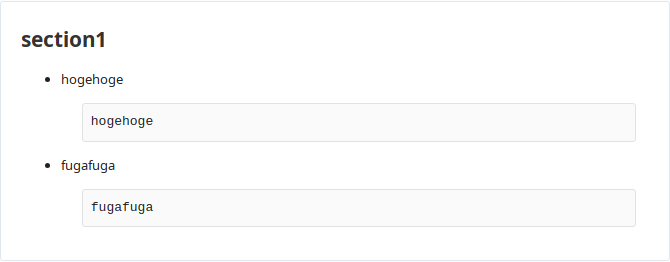

### case02: should add blank line between code block and header

[input.md](case02/input.md) · [golden](case02/golden)

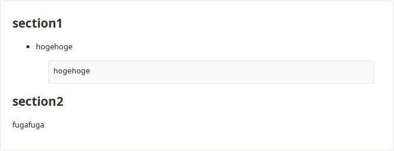

### case03: should handle code blocks with language specification

[input.md](case03/input.md) · [golden](case03/golden)

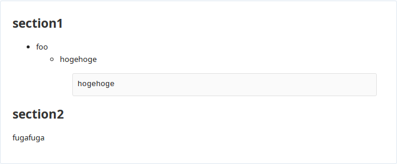

### case04: should render pipe tables as Textile even when widths are inferred

[input.md](case04/input.md) · [golden](case04/golden)

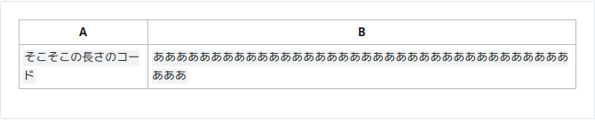

## Redmine's RedCloth rules (Golden tests)

### case05: should escape characters that Redmine would take as markup

[input.md](case05/input.md) · [golden](case05/golden)

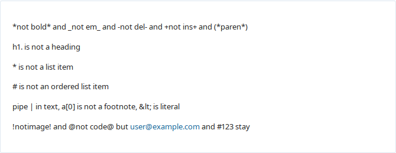

### case06: should separate inline markup from adjacent Japanese text

[input.md](case06/input.md) · [golden](case06/golden)

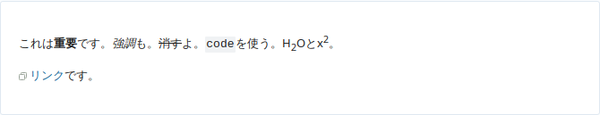

### case07: should not insert a space at line breaks between Japanese characters

[input.md](case07/input.md) · [golden](case07/golden)

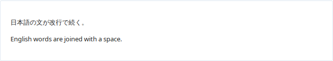

### case08: should escape delimiters inside markup and use &lt;code&gt; where @ does not work

[input.md](case08/input.md) · [golden](case08/golden)

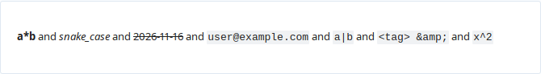

### case09: should keep table cells on one row and put the caption before the table

[input.md](case09/input.md) · [golden](case09/golden)

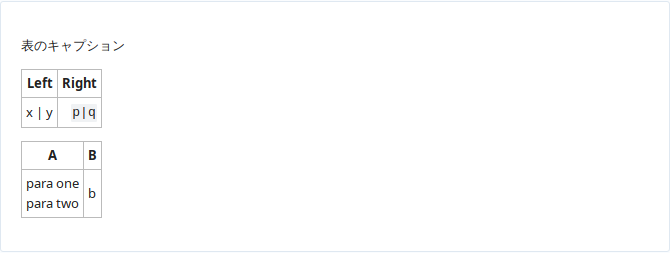

### case10: should not emit start numbers of ordered lists

[input.md](case10/input.md) · [golden](case10/golden)

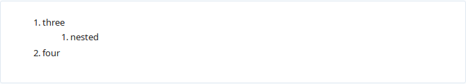

### case11: should end a figure paragraph and link images

[input.md](case11/input.md) · [golden](case11/golden)

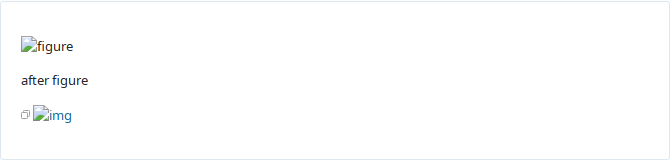

### case12: should recognize blocks without a preceding blank line and keep dashes

[input.md](case12/input.md) · [golden](case12/golden)

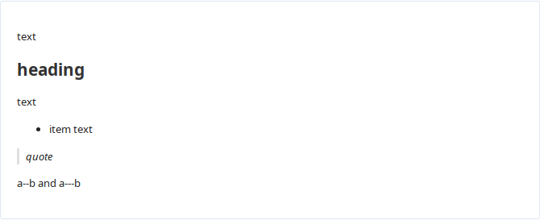

### case13: should keep all paragraphs of a footnote in the footnote

[input.md](case13/input.md) · [golden](case13/golden)

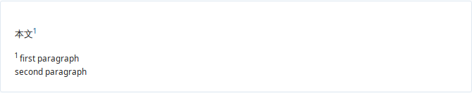

### case14: should render definition lists without HTML tags

[input.md](case14/input.md) · [golden](case14/golden)

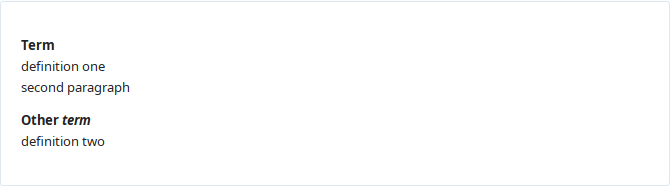

### case15: should link to headings with Redmine's anchor names

[input.md](case15/input.md) · [golden](case15/golden)

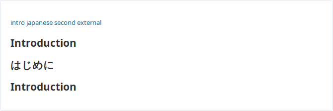

### case16: should drop raw HTML that Redmine would show as text

[input.md](case16/input.md) · [golden](case16/golden)

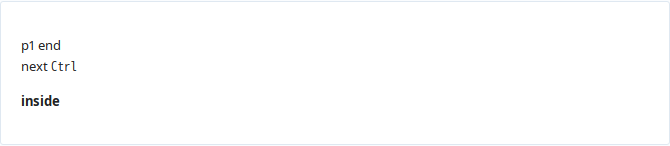

### case17: should render autolinks and link titles

[input.md](case17/input.md) · [golden](case17/golden)

### case18: should ignore a hard line break at the end of a list item or paragraph

[input.md](case18/input.md) · [golden](case18/golden)

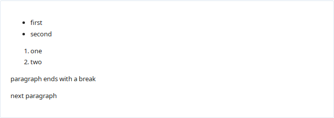

### case19: should keep a list going after a collapse macro, and end it before the next block

[input.md](case19/input.md) · [golden](case19/golden)

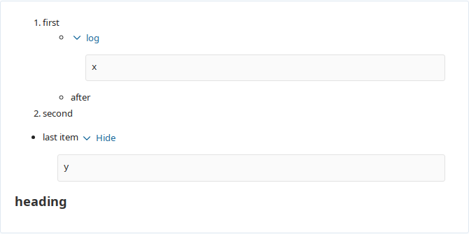

### case20: should turn &lt;details&gt; into the collapse macro, expanding nested ones

[input.md](case20/input.md) · [golden](case20/golden)

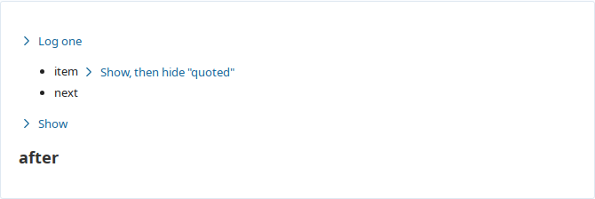

### case21: should render grid and multiline tables with a caption as Textile tables

[input.md](case21/input.md) · [golden](case21/golden)

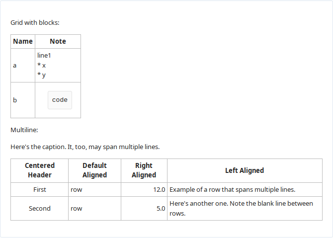

### case22: should turn mermaid code blocks into the mermaid macro where a macro can hold them

[input.md](case22/input.md) · [golden](case22/golden)

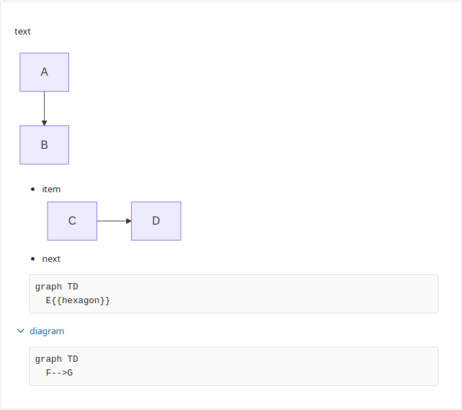

### case23: should start a code block at a fence right after a line of text

[input.md](case23/input.md) · [golden](case23/golden)

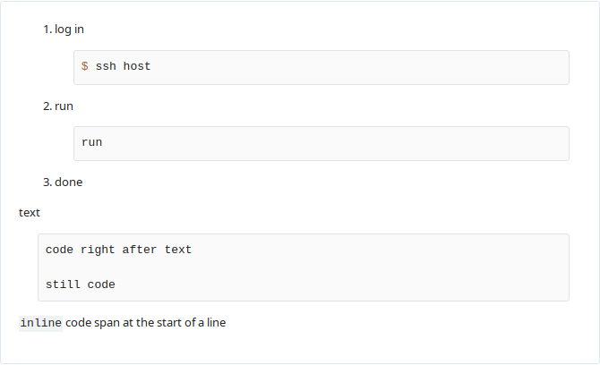

### case24: should close an unclosed code fence where its list item ends

[input.md](case24/input.md) · [golden](case24/golden)

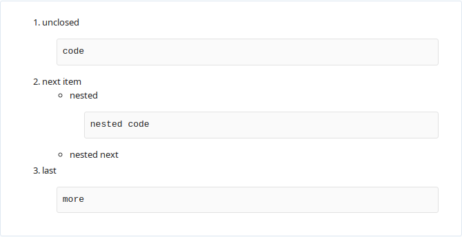

### case25: should continue text right after a code block in a list item

[input.md](case25/input.md) · [golden](case25/golden)

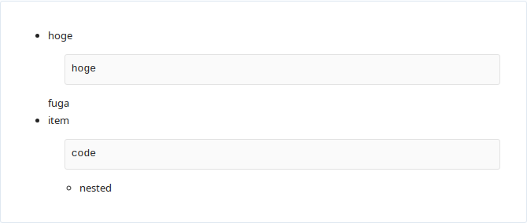
